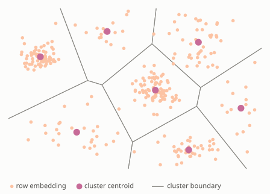
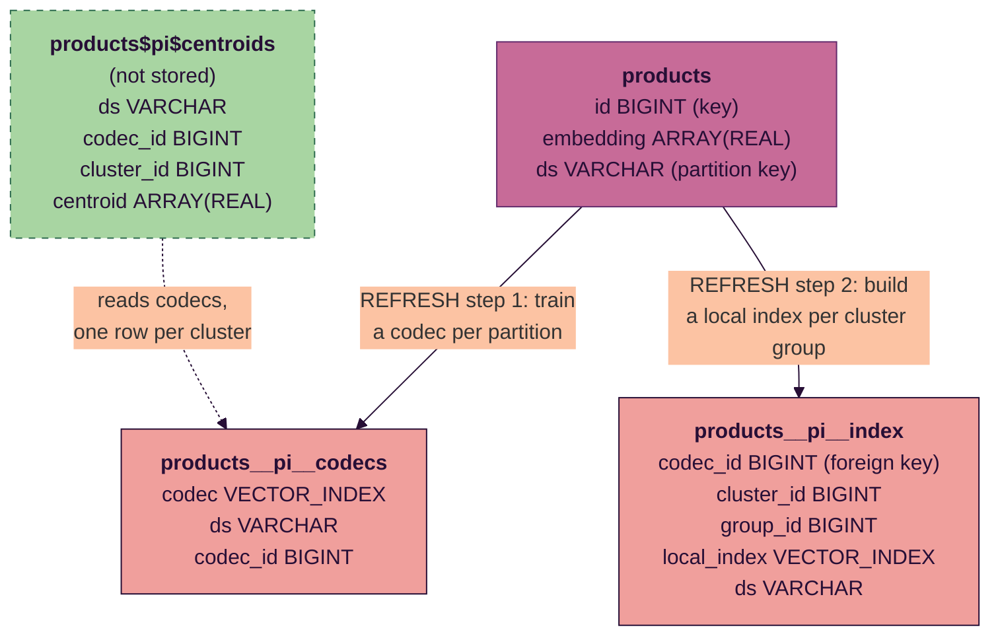
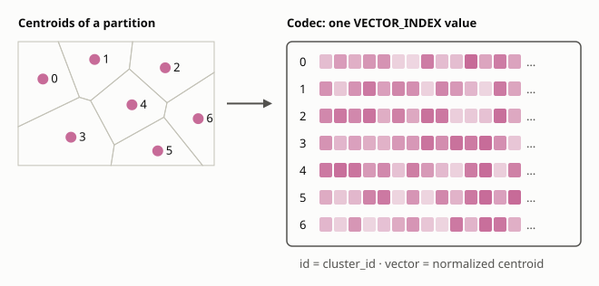

# Vector Search

*Vector indexes on tables: how an index is stored, built by REFRESH and
searched by `vector_search`, and what a connector implements to support them.
The syntax and the user-facing properties are in
[VectorIndexes.md](../sql/presto/docs/VectorIndexes.md).*

**Status:** cosine distance, BIGINT keys, partitioned tables and one codec
per partition. Local Hive and the test connector implement the connector's
part. See [Not supported yet](#not-supported-yet).

## Overview

A vector search finds, for each query embedding, the `k` rows of a table whose
embeddings are nearest. Comparing a query with every row is exact but reads
the whole table. A vector index makes the search approximate and cheap:

- The rows of each partition are grouped into clusters. Each cluster is
  represented by its centroid, the mean of its rows' embeddings.
- Each cluster's rows are stored in local indexes, FAISS indexes of up to
  50,000 embeddings each.
- A search finds each query's nearest clusters, searches only their local
  indexes and keeps the `k` nearest rows overall.

The diagram shows a partition's embeddings in two dimensions. Each region holds
the rows nearest one centroid, so a search reads only the regions whose
centroids are nearest the query:



The engine owns the index: it defines the format, builds the index and
searches it. A connector stores it as two ordinary tables, plus metadata that
links an embedding column of the table to its index.

## Index structure

An index of table `t` on an embedding column, an ARRAY(REAL), with a BIGINT
key column, has two storage tables, both partitioned by `t`'s partition
columns. For example, an index `pi` of `products`, partitioned by
`ds`:



| Table | One row per | Columns |
|---|---|---|
| Codec table | partition and codec | `codec`, partition columns, `codec_id` |
| Index table | group of a cluster | `codec_id`, `cluster_id`, `group_id`, `local_index`, partition columns |

- A **codec** holds a partition's centroids: a flat FAISS index over the
  normalized centroids, with each cluster's id as its centroid's id.
- `codec_id` identifies the index write that trained the codec. A
  partition's local indexes all name one codec. A write that never ended can
  leave other codecs in the partition, which no local index names, until the
  next write of the partition drops them. The partition columns and `codec_id`
  are the codec table's primary key.
- A **local index** holds one group of one cluster's rows, with each row's key
  as its id. A cluster larger than 50,000 rows is split into groups.
- The `codec` and `local_index` columns are of type VECTOR_INDEX.

The codec of the partition in the [Overview](#overview) diagram packs its
seven centroids into one value:



The engine reserves a third name, `"t$<index>$centroids"`, for a table of
`(partition columns, codec_id, cluster_id, centroid)` with a row per cluster.
Nothing stores or writes it. A vector search of it is planned as a search of
the codec table, which lets a logical plan assign rows to clusters. It has the
clusters of every codec in the codec table.

An empty partition has a NULL codec and one index row of NULLs. It is covered
and matches nothing.

`VectorIndex` (`axiom/connectors/VectorIndex.h`) describes an index the same
way for every connector: its name, columns, properties, storage tables and
their types.

### Valid rows

The index holds the rows whose key is not NULL and whose embedding:

- is not NULL;
- has `dimension` elements;
- has no NULL, NaN or infinite element;
- is not all zeros.

REFRESH skips the other rows. A search never returns them.

### Coverage

The index does not follow its table's data. Only REFRESH builds it.

- A partition is covered when the index table has it. A table without
  partition columns is covered when the index table has rows.
- A write that changes a partition's rows removes the partition from the
  index, in the same write. A write that adds a new partition leaves the
  index alone, and the new partition is uncovered.
- A search that selects an uncovered partition fails at planning, naming the
  partition.

## Who does what

| Engine | Connector |
|---|---|
| Defines the storage tables' types and names | Creates, stores and drops the storage tables |
| Validates index definitions | Records the link between `t` and its indexes |
| Plans REFRESH: training, assignment, building | Commits index writes and generates codec ids |
| Plans the search and picks the index | Checks coverage from a handle's filters |
| Rejects schema changes that drop or rename the embedding or key column | Removes a partition from the index when a write changes its rows |

This reverses the usual roles. For a table or a lookup index, the connector
describes what it has and the optimizer adapts. For a vector index, the
engine defines the contract and a connector implements it.

The connector does no index work on its own. The engine's scans and writes of
the storage tables are ordinary scans and writes, and the connector does not
tell them apart from a user query's.

## Defining an index

An index is declared with its table in CREATE TABLE, or added to an existing
table with ALTER TABLE:

```sql
CREATE TABLE products (
    id BIGINT,
    embedding ARRAY(REAL),
    ds VARCHAR,
    PRIMARY KEY (id),
    VECTOR INDEX pi (embedding) WITH (
        distance_metric = 'cosine',
        index_type = 'ivf_flat',
        num_clusters = 1000,
        dimension = 768))
WITH (partitioned_by = ARRAY['ds'])

ALTER TABLE products ADD VECTOR INDEX pi (embedding) KEY (id)
WITH (distance_metric = 'cosine', index_type = 'ivf_flat',
      num_clusters = 1000, dimension = 768)
```

- The key defaults to the table's primary key and must be one BIGINT column.
- The properties choose the metric, the local index type, the number of
  clusters per partition and the embeddings' length. Any other property is a
  table property of both storage tables, which the connector defines, e.g.
  Local Hive's `format` and `compression_kind`.
- The engine validates the definition, then the connector creates the storage
  tables and records the link.
- A new index covers no partition. REFRESH builds it.

`ALTER TABLE products DROP VECTOR INDEX pi` drops the link and the storage
tables. The full syntax and properties are in
[VectorIndexes.md](../sql/presto/docs/VectorIndexes.md).

## REFRESH

`REFRESH VECTOR INDEX i ON t WHERE <partition filter>` builds the index for
the partitions the filter selects. `VectorIndexRefresh::plan`
(`axiom/sql/presto/VectorIndexRefresh.h`) returns two logical plans, each
taking the write's codec id as parameter `?1`. The runner runs them as one
index write:

1. `co_beginVectorIndexWrite` generates the codec id.
2. The train plan writes a codec per partition to the codec table.
3. The build plan writes the local indexes to the index table.
4. `co_finishVectorIndexWrite` drops the codecs no local index names and
   returns the number of embeddings indexed. On any failure the runner calls
   `co_abortVectorIndexWrite` instead.

Both plans read the selected partitions' valid rows. A row with a NULL
partition value fails the refresh.

### Train

```
TableWrite <codec table>, codec_id = ?1
  LeftJoin on partitions
    Aggregate distinct partitions          -- every selected partition
    Aggregate vector_index_train(embedding, key, num_clusters, metric)
              by partitions
      Filter sample_row <= 256 * num_clusters
        Window sample_row := row_number() by partitions
                             ordered by xxhash64(key)
          valid rows
```

- **Sample.** Up to 256 points per cluster from each partition, chosen by a
  hash of the key, so the sample is the same on every run.
- **Train.** The `vector_index_train` aggregate clusters each partition's
  sample with FAISS's spherical k-means and returns the codec of the
  clusters. It orders the sample by key first, so the codec does not depend
  on the order rows arrive in.
- The left join writes a NULL codec for a selected partition with no valid
  rows.

### Build

```
TableWrite <index table>, codec_id = ?1
  LeftJoin on partitions
    Aggregate distinct partitions
    Aggregate vector_index_build(embedding, key, ...) by partitions, cluster_id, group_id
      Project group_id := (cluster_row - 1) / 50000
        Window cluster_row := row_number() by partitions, cluster_id
          VectorSearch k = 1                       -- nearest cluster
            valid rows
            Filter codec_id = ?1 / Scan "t$i$centroids"
```

- **Assign.** A vector search of the centroids table with `k` = 1 gives each
  row its nearest cluster in its partition's new codec.
- **Group.** Rows are numbered within each cluster and split into groups of
  up to 50,000.
- **Build.** The `vector_index_build` aggregate builds a local index of the
  index's type over each group.

The build reads `t` again. A row of a partition the train plan did not see,
e.g. one a concurrent write added, has no codec and fails the refresh.

REFRESH does not read the index's existing partitions. A selected partition
that is already covered fails the refresh.

### Index writes

Each insert of the train and build plans commits on its own. A write the
engine never ends, e.g. because the coordinator died, leaves only states a
search tolerates:

- a codec no local index names is unused;
- local indexes always name an existing codec.

The next write of those partitions cleans them up.

## Search

`vector_search` over a table translates into a `VectorSearch` node whose build
side is a scan of the table. `VectorIndexSearch::plan`
(`axiom/optimizer/VectorIndexSearch.h`) picks the index and replaces the node
with two searches over ordinary scans of the storage tables:

```
Filter rank <= k
  Window rank := row_number() by query_id ordered by score DESC
    VectorSearch (partitions, codec_id, cluster_id) =, local_index, k
      VectorSearch codec, k = num_probes
        AssignUniqueId query_id
          probe
        Filter <partition filter> / Scan <codec table>
      Filter <partition filter> / Scan <index table>
```

- **Pick the index.** The index on the searched column with the search's
  metric: the one the `index` hint names, or else the only one.
- **Check coverage.** The planner builds a handle of `t` with the partition
  filters and calls `TableLayout::co_checkVectorIndexCoverage`, which fails
  if a selected partition is not covered.
- **Assign.** The first search matches each query with its partitions' codecs
  and returns its `num_probes` nearest clusters in each.
- **Search.** The second search matches each (query, partition, codec,
  cluster) with that cluster's local indexes and returns up to `k` rows from
  each, with scores.
- **Merge.** The window keeps each query's `k` best rows. A later pass fuses
  the window and the filter into a TopNRowNumber.

The partition filters are pushed into both scans, so the search reads only the
selected partitions. The scans are plan nodes with real columns: the optimizer
costs them and places their exchanges.

The output has the probe's columns, `t`'s key and partition columns of each
match, and the score. For cosine, the score is the cosine similarity: larger
is nearer.

A search of `"t$i$centroids"` is one search of the codecs of the selected
partitions, returning each match's cluster. A query that matches several
codecs keeps its `k` nearest clusters across them. A query matches at most one
codec when each column of the codec table's primary key is a search key or is
made constant by a filter. The search then returns its matches as they are.
REFRESH's search keys every partition column and filters on one `codec_id`.

The centroids search is not checked for coverage: REFRESH searches codecs
whose partitions have no local indexes yet.

### Velox

Both searches run as Velox's `VectorSearchJoinNode`. Like a hash join, it
holds its build side in memory and streams its probe side. Either side can
have the indexes, and the optimizer holds the one with fewer estimated bytes:

- With the indexes held, the build side decodes each codec or local index
  once and maps the equality keys to it. The probe groups a batch's rows by
  the index they match and searches each index once for all of them.
- With the queries held, each index streams past once: it is decoded,
  searched for every query that matches it, and dropped. Memory is bounded by
  the queries. The local-index search runs this way when the local indexes
  outweigh the queries' assignments to clusters.
- The packed bytes are not copied into output rows.

### User errors

The search fails at planning:

- without an index on the searched column with the search's metric, or with
  several and no `index` hint;
- for a condition on a column other than a partition column, which would need
  a filtered search inside a local index;
- for a join other than INNER, for join keys, or for reading a column of `t`
  other than the key and the partition columns;
- for a search of a centroids table with a metric other than the index's.

## Implementing a connector

Supporting vector indexes is optional, and any connector that supports
writes can add it. The engine builds and searches the index; the connector
only stores two tables per index and the link from the table to its indexes,
and keeps them in step with the table's writes. The connector does not need
to know how centroids are trained and packed into codecs, or how local
indexes are built and searched: to the connector, `codec` and `local_index`
are opaque values in ordinary tables. A connector opts in by
setting `vectorIndexes` in the `TableDefinitionSupport` that
`supportsCreateTable()` returns; without it, the engine rejects index
definitions and DROP VECTOR INDEX.

The API is in `axiom/connectors/ConnectorMetadata.h`.

- **Add an index.** `co_addVectorIndex` validates the definition (an
  ARRAY(REAL) embedding column, a BIGINT key column) and calls
  `co_doAddVectorIndex`. The connector creates the storage tables with
  `VectorIndex::codecTableType` and `indexTableType` and records the link. By
  default the tables live in `t`'s schema as `<t>__<i>__codecs` and
  `<t>__<i>__index`. `co_doCreateTable` receives the indexes a CREATE TABLE
  declares, as `ResolvedVectorIndex`.
- **Drop an index.** `dropVectorIndex` calls `doDropVectorIndex`, which
  removes the link and the tables. Dropping `t` drops its indexes.
- **Expose the link.** `Table::vectorIndexes()` and `findVectorIndex(name)`.
  An index is metadata of `t`, not a layout: no read of `t` goes through it.
- **Store the tables as ordinary tables.** `findTable` resolves them, and the
  connector supports scans, inserts and partition deletes on them, whether or
  not it lists them.
- **Resolve `"t$i$centroids"`** in `findTable` to a table of
  `VectorIndex::centroidColumns()`. It needs no data.
- **Commit index writes.** `co_beginVectorIndexWrite` generates the codec id.
  `co_finishVectorIndexWrite` drops the codecs no local index names in the
  partitions the write wrote and returns the number of embeddings, using only
  what the inserts recorded. `co_abortVectorIndexWrite` drops the write's
  codec from each partition whose local indexes do not name it.
- **Keep indexes in step with `t`.** A write that changes a partition's rows
  removes the partition from each index's storage tables.
- **Check coverage.** `TableLayout::co_checkVectorIndexCoverage` fails with a
  user error naming a partition the handle's filters select that the index
  does not cover.

Local Hive's implementation is described in
[connectors/hive/README.md](../connectors/hive/README.md#vector-indexes).

## Alternative: an index stored with the data

*A design, not built yet.*

The index above is stored apart from its table. A file format can instead
store an index inside each data file. Nimble does: a file can hold a FAISS
index of one ARRAY(REAL) column, built when the file is written. A search of
the file returns row numbers, so a reader can then read any column of the
matches. A search can also be limited to a bitmap of eligible rows, which
serves a filter on any column.

| | Index stored apart | Index in each file |
|---|---|---|
| Keeping up with the data | REFRESH builds it; a write uncovers a partition | Written with the data, always current |
| What a search returns | Key and partition columns | Any column |
| Filters | Partition columns only | Any column |
| Files a search reads | The probed clusters' local indexes | Every file the scan selects |
| Training | Per partition, on a sample of all its rows | Per file, on that file's rows |
| Changing index settings | Drop, add and refresh the index | Rewrite the data |

### Data layout decides the cost

When rows land in files in no particular order, every file holds rows of
every cluster. A search must then search the index of every file the scan
selects, keep the `k` nearest of each, and merge. Each file's index is
trained on that file alone.

The number of files decides the cost. A partition of a few large files
costs a few searches of well-trained indexes. A partition of many small
files costs many searches of indexes too small to train well.

To search only some files, the files must follow the clusters:

- The codec exists before the data is written.
- The write assigns each row to its cluster and groups rows by cluster.
- Each file holds whole clusters, or part of one large cluster.

A search then assigns each query to its nearest clusters, as it does today,
and reads only those clusters' files. This is the index stored apart, with
the local indexes moved into the data files: the table's own files take the
place of the index table, and a match reads any column without a join.

The layout has costs. The codec must be trained before the write, e.g. on an
earlier partition. Every write shuffles rows by cluster. A table is laid out
one way, so clustering by embedding gives up clustering by anything else.

A small table works well with any layout. A partition of one or a few files
costs a few searches, and each file's index is trained on most of the
partition.

### Plan

A search of a table whose files carry an index maps onto an index lookup
join:

- The probe side is the queries.
- The lookup side is a scan of the table, filtered on any columns.
- Each file returns, for each query, its `k` nearest rows that pass the
  filter, with the requested columns and the score.
- The per-query merge that the search plans today keeps the `k` best overall.

The connector advertises the index in the table's layout, as it advertises
lookup keys. The optimizer chooses between the index stored apart, the index
in each file, and an exact search. With a cluster-aligned layout, the lookup
also prunes files by cluster.

## Not supported yet

- Distance metrics other than cosine.
- Keys other than one BIGINT column.
- A codec shared by all partitions (`codec_policy = 'shared'`).
- REFRESH of a table without partition columns.
- REFRESH of a covered partition.
- Filters on non-partition columns inside the search.
- Joins other than INNER, and reading columns of `t` other than the key and
  partition columns; join the result back to `t` instead.
- Index formats other than FAISS.

## Follow-ups

- **Read only the probed clusters.** The search reads every local index of
  the selected partitions, however few clusters the queries probe.
  Bucketing or sorting the index table by `cluster_id`, and passing the
  probed clusters to the index scan as a dynamic filter, lets the scan skip
  the rest.
- **Rebuild a covered partition.** Once connectors support INSERT OVERWRITE,
  REFRESH can write a new codec and overwrite the partition's local indexes in
  one swap. Finish already drops the old codec.
- **One listing per query.** The coverage check lists partitions at planning,
  and split generation lists the index's partitions again. Once connectors
  keep per-query state, split generation can reuse the listing.
- **Show an index's partitions and stats.** A user sees an index's settings
  in SHOW CREATE TABLE but has no way to see which partitions it covers or
  how many embeddings each holds, short of knowing the connector's names for
  the storage tables. A virtual table per index, `"products$pi$partitions"`,
  named like the centroids table, would list each covered partition with its
  `codec_id` and number of embeddings. Each connector fills it from metadata.
  A write to it fails, since a connector resolves only stored tables for a
  write.
