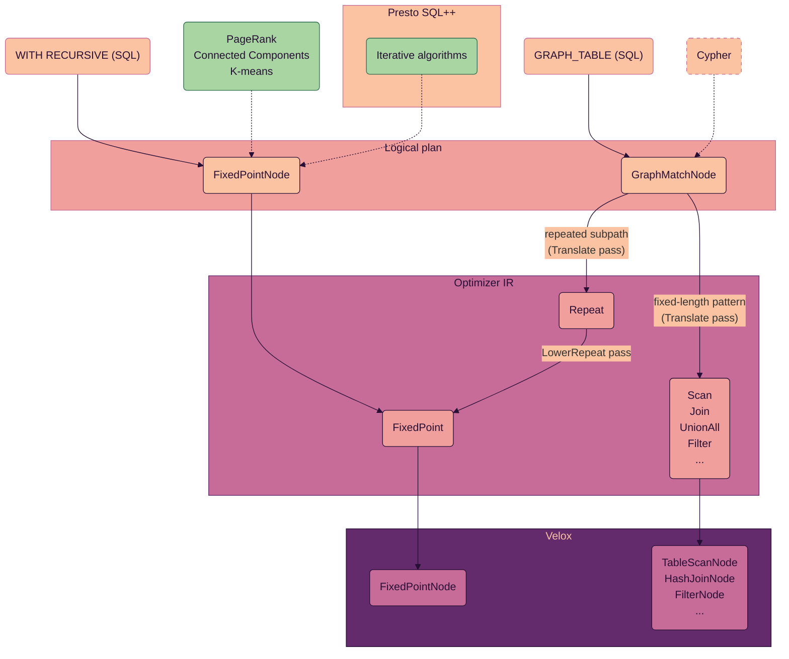

# Fixed Point

*Loops: recursive queries and repeated graph paths, from the logical plan to
Velox; the `FixedPoint` / `WorkingTable` IR nodes, the invariants each pass must
preserve, and what is rejected.*

**Status:** recursive queries, repeated graph patterns and iterative
algorithms plan and run on one or more workers — see [Use cases](#use-cases)
and [Distributed execution](#distributed-execution). Nested recursion, multiple
recursive references per step of a loop that appends, and multiple fixed
points per execution fragment are rejected — see
[Not supported yet](#not-supported-yet).

## Introduction

Most SQL queries have linear logical chains: data flows from input sources to
output results. Iterative and recursive logic is historically uncommon, but
matters for newer workloads like graph and vector search.

A **fixed point** operator is a customizable for-loop:

```
delta = anchor();
result = delta;
while (!convergence(delta)) {
  delta = step(delta);
  result += delta;
}
```

Reaching `maxIterations` without `convergence` holding is an error unless the
loop asks for its current result — see invariant 5.

Three components describe it:

- **`anchor()`** — initializes the set.
- **`step(delta)`** — the loop body.
- **`convergence(delta)`** — decides when to terminate.

In practice a **recursion limit** bounds the loop. A loop can also
**replace** its state each iteration and return the last one, as PageRank
does, instead of appending every iteration's rows.

## Use cases

Graph and iterative work reaches the optimizer in two shapes, and each has
its own logical plan node:

- **A pattern:** which vertices connect to which, along which edges.
  `GRAPH_TABLE` states it declaratively, and a front-end turns it into a
  `GraphMatchNode` ([GraphTable.md](GraphTable.md)). Most of a pattern is
  joins; only a repeated subpath, such as `-[IS Knows]->{1,3}`, iterates.
- **A loop:** an anchor, a step, and a stop condition. `WITH RECURSIVE` states
  one, and a front-end that builds logical plans directly can too; either way
  it becomes a `FixedPointNode`. Iterative algorithms such as PageRank, connected
  components and k-means are loops too. A recursive query adds new rows each
  iteration; these refine the same rows instead: a rank per vertex, a
  component per vertex, a centroid per cluster.
  [FixedPoint-pagerank.md](FixedPoint-pagerank.md),
  [FixedPoint-connected-components.md](FixedPoint-connected-components.md)
  and [FixedPoint-kmeans.md](FixedPoint-kmeans.md) follow each from the
  logical plan to its distributed Velox plan.

| Use case | Logical plan | Optimizer IR | Velox |
| --- | --- | --- | --- |
| `WITH RECURSIVE` | `FixedPointNode` | `FixedPoint` over a `WorkingTable` | `FixedPointNode` |
| `GRAPH_TABLE` without repetition | `GraphMatchNode` | `Scan`, `Join`, `UnionAll`, `Filter`, `RowNumber`, ... | no loop |
| `GRAPH_TABLE` with repetition | `GraphMatchNode` | `Repeat`, lowered to `FixedPoint` | `FixedPointNode` |
| PageRank, connected components, k-means | `FixedPointNode` | `FixedPoint` with replaced state and a `convergence` | `FixedPointNode` |



Two logical nodes keep each shape's intent. A `GraphMatchNode` carries the
graph and the whole pattern, so Translate can choose the tables each pattern
matches and hand the joins to join ordering and pushdown. A `FixedPointNode`
describes the loop itself, so there is nothing more declarative to keep.

The IR keeps a walk visible a little longer
([GraphTable-repetition.md](GraphTable-repetition.md)):

1. Translate lowers a repeated subpath to a `Repeat`, which names the walk's
   start, hop and end, and its hop bounds.
2. The passes up to `EstimateLeafStats` treat the `Repeat` as an operator over
   those inputs.
3. `LowerRepeat` turns it into a `FixedPoint` that starts from the side with
   fewer estimated rows.
4. From there on, physical planning, Emit and execution see one loop node for
   every use case.

## End-to-end mapping

A counter query:

```sql
WITH RECURSIVE counter(n) AS (
  SELECT 1                                -- anchor
  UNION ALL
  SELECT n + 1 FROM counter WHERE n < 10  -- step
)
SELECT * FROM counter;
```

It maps directly onto the loop above: the anchor is `SELECT 1`, the step is
`SELECT n + 1 WHERE n < 10`, the loop stops once an iteration adds no rows, and
the result is `{1, 2, … 10}`. Every fixed point the optimizer plans stops this
way; a partitioned loop stops once no worker's iteration adds rows (see
[Distributed execution](#distributed-execution)).

### 1. Logical plan

The self-reference is a `RecursiveReferenceNode`. There is no working table
yet — Translate introduces it.

```
- Project                                  (SELECT *)   -> n:INTEGER
  - FixedPoint[name=counter]                             -> n:INTEGER
    anchor:
    - Values (1)                                         -> n:INTEGER
    step:
    - Project n + 1
      - Filter n < 10
        - RecursiveReference[counter]                    -> n:INTEGER
```

### 2. Optimizer IR

The IR tracks internal details that change over time.

```
- FixedPoint[name=counter, maxIterations=1000] -> c01:INTEGER
  anchor:
  - Values -> c01:INTEGER
  step:
  - Project -> expr2:INTEGER
    expr2 := plus(c01, 1)
    - Filter -> c01:INTEGER
      predicate: lt(c01, 10)
      - WorkingTable[name=counter, readMode=latestDelta] -> c01:INTEGER
```

### 3. Velox plan

The delta / working-table representation becomes a state that outlives
iterations and is seeded from the anchor.

```
- ProjectNode                                        (SELECT *)
  - FixedPointNode[state=counter, maxIterations=1000]
      stateDeclarations:
        VectorStateDeclaration[counter, append=true]:
          - ValuesNode                               (VALUES 1)   <- seeds state
      plans (step):
        - ProjectNode  n + 1
          - FilterNode  n < 10
            - StateSourceNode[counter, delta=true]                <- latest delta
      convergence: stop when an iteration writes no rows
```

### Cross-layer correspondence

| Logical plan | Optimizer IR | Velox plan |
| --- | --- | --- |
| `RecursiveReferenceNode[counter]` | `WorkingTable[counter, latestDelta]` | `StateSourceNode(counter, delta=true)` |
| — | inner equi-join in the step, build side without a `WorkingTable` | `HashTableStateDeclaration` + `StateHashJoinNode` |
| — | other subtree of the step without a `WorkingTable` | `VectorStateDeclaration` + `StateSourceNode(delta=false)` |
| anchor branch | anchor branch | `VectorStateDeclaration(counter, append=true)` |
| — | `FixedPoint` without `convergence` | `ConvergenceConfig::whenDeltaEmpty(maxIterations)` |
| — | `convergence` with a gather `Exchange` | `ConvergenceConfig::globalVerdict`: the plans before the gather run on every worker, the last on worker 0, the task with destination 0 |
| — | `convergence` without one | `ConvergenceConfig::converging`: the plan runs on every worker |
| — | `Exchange` on the step's path from its `WorkingTable` | `PartitionedOutput` ending one body plan, `Exchange` starting the next |

`WorkingTableReadMode` also has an `kAccumulated` mode, which emits
`delta=false` — a read of the whole state rather than the last iteration's
output. Translate does not produce it; steps that read the whole result, such
as shortest paths, need it.

## Invariants

Each item below is one `VELOX_CHECK` in the `FixedPoint` or `WorkingTable`
constructor. Stated up front so they can be checked against rather than
inferred.

1. **Named state.** A `FixedPoint`'s name is non-null, and a `WorkingTable`
   references its fixed point by that name: the constructor rejects a branch that
   reads any state other than the one this fixed point binds. An orphan recursive
   reference with no enclosing fixed point is rejected in Translate.

2. **Each branch reads the state it should, with the state's own columns.** The
   anchor must read no recursive state at all; the step must read exactly this
   fixed point's state, through reads whose state columns are pointer-identical
   to the fixed-point output. A loop that appends reads it once in its step and
   once in its convergence; a loop that replaces its state may read it any
   number of times. `Node::requiredStates()` carries, per node, the recursive
   states that subtree needs an enclosing `FixedPoint` to provide, each mapped
   to what its reads present, the columns and the partitioning: the union of its
   inputs' entries, where a `WorkingTable` requires the state it reads and a
   `FixedPoint` satisfies the one it binds. The map is empty for a
   self-contained subtree, and the constructor checks presence *and* column
   identity with one lookup per branch instead of searching the subtrees. Two
   reads of one state that disagree on columns or partitioning are rejected
   where they meet. `Builder::make` primes the map once per node, so a shared
   subplan is walked once.

3. **Schema equivalence, not name equality.** Anchor and step output types must
   be equivalent in types and positions, not identical column ids. The step's
   final projection may allocate fresh canonical ids from the shared
   `NameAllocator`, so an identity check would spuriously fail.

4. **Recursive-state identity is explicit.** Each `WorkingTable` carries the
   fixed-point output as its `stateColumns` and presents them under its own
   fresh `outputColumns`, aligned by position, so two reads are distinct
   relations, as two scans of one table are. The anchor supplies the initial
   values through the positionally aligned `sourceColumns`. A pass may rewrite
   columns within a branch as long as it restores both boundary schemas before
   rebuilding the `FixedPoint`.

5. **Bounded.** `maxIterations >= 1`. A SQL recursive CTE carries no depth hint of
   its own, so it inherits the session `recursion_limit` (default 1000) as a
   safety cap; a shape with its own bound — a `1..5` hop pattern — sets
   `maxIterations` per node instead. `failAtBound` says what reaching the
   bound does: a recursive CTE fails rather than returning a partial answer,
   and an iterative algorithm may return its current state. Emit sets
   `errorWhenMaxIterationReached` from it.

6. **The state's placement holds across iterations.** A `WorkingTable`'s
   `partitioning` says where the state lives: gathered, hash-partitioned on
   some of its columns, or unspecified. When it is gathered or
   hash-partitioned, the anchor and the step arrive placed the same way, on
   their columns at the same positions, so every iteration finds the state
   where the read says it is. The read's partitioning travels to the
   `FixedPoint` in `requiredStates()`, next to its columns.

7. **Convergence.** A `FixedPoint` without `convergence` stops once an
   iteration adds no rows. `convergence`, when set, reads the state as the
   step does and outputs one BOOLEAN column; the loop stops once it is true.
   A step with an `Exchange` on its path from its `WorkingTable` has a
   `convergence`: workers that repartition rows must stop together. In a loop
   that replaces its state, the latest delta is the state.

## What each pass does with a fixed point

In pipeline order:

- **Translate** — lowers a recursive CTE into `FixedPoint(anchor, step)`, and
  each recursive reference into a latest-delta `WorkingTable` with fresh
  columns. A loop that replaces its state carries its mode, its convergence,
  and what reaching its bound does. It lowers a graph pattern's
  fixed-length parts into joins and each repeated subpath into a `Repeat`.

- **LimitAndOrder** — treats `FixedPoint` and `WorkingTable` as limit
  barriers: a `LIMIT` or an ordering above the loop stays above it.

- **PushdownAndPrune** — keeps a filter above the loop above it, since a filter
  on the seed rows can drop rows they lead to that the filter accepts (first
  version; see [Follow-ups](#follow-ups)). Inside each branch, the convergence
  included, pushdown and pruning work as usual, and the pass restores each
  branch's output columns before rebuilding the `FixedPoint` (invariant 4). The
  branches report no non-null columns, so outer-join reduction keeps a
  null-padded seed row whose descendants become non-null through `coalesce`.
  Here and in Translate and EstimateLeafStats, a step or a convergence that
  simplification leaves reading no state fails the query: it is a mistake in
  the plan.

- **EstimateLeafStats** — `FixedPoint` and `WorkingTable` report unknown
  cardinality, so a join cluster that reads a loop keeps its written join shape
  at that boundary (first version; see [Follow-ups](#follow-ups)).

- **LowerRepeat** — after `EstimateLeafStats`, turns each `Repeat` into a
  `FixedPoint` that starts from the side with fewer estimated rows
  ([GraphTable-repetition.md](GraphTable-repetition.md)).

- **PlanPhysical** — plans the anchor with the query's workers, and the step
  with the query's drivers per task. A step's driver-level planning adds the
  local exchanges it needs, as for any subtree. Velox runs the last plan of a
  `convergence` on one driver, so PlanPhysical plans that plan for one: the
  whole `convergence` of a loop on one task or over a replicated state, and in
  a partitioned loop the part after its gather. With several workers it places the loop as
  independent loops, as one partitioned loop, or with its state replicated on
  every worker — see [Distributed execution](#distributed-execution). A partitioned loop plans its
  `convergence` with the query's workers, split at a gather into per-worker
  partial results and a verdict on one task. A partitioned loop without one
  gets `count(*) = 0` over the latest delta: each worker counts its rows, and
  the counts are gathered and added up on one task. A query whose function
  registry lacks `count` or equality fails. In a partitioned loop's step, each
  join takes as its probe side the input that reads the exchange, since Velox
  drives each body plan from the exchange that links it to the plan before; a
  loop with a join that cannot take that side runs on one task.

- **Emit** — emits `ConvergenceConfig::whenDeltaEmpty(maxIterations)` for a
  fixed point without `convergence`: Velox stops on the row count of the delta
  it already holds. Emit cuts the step at each `Exchange` between workers on its
  path from the `WorkingTable` into the next body plan, and the `convergence`
  the same way:
  the plans before its gather run on every worker, and the last one on worker
  0, which shares its answer (`ConvergenceConfig::globalVerdict`); the
  convergence of a loop on one task runs there
  (`ConvergenceConfig::converging`). Over a replicated state, worker 0 runs
  the convergence over its own copy and shares its answer
  (`ConvergenceConfig::workerZeroVerdict`), and only worker 0 emits the output
  (`FixedPointNode::outputOnWorkerZero`). Velox requires each body plan after the
  first to read exactly one exchange, as its primary input. PlanPhysical placed
  every exchange, and Emit translates them. Emit declares the state append or
  replace as the fixed point's mode says, and emits each `WorkingTable` as its
  own `StateSourceNode`. An exchange across the drivers of a task stays inside
  its body plan as a `LocalPartition`. The runner gives each iteration's plans
  the query's drivers per task (`FixedPointOptions::iterationMaxDrivers`).

  A fixed point's fragment takes its type from its anchor alone, since the step
  and the convergence run in sub-tasks of the anchor's tasks:
  - a source fragment when the anchor scans a table;
  - a single-task fragment when the anchor is gathered;
  - a fixed-width fragment when the anchor is repartitioned.

  Velox delivers splits to a fixed point's initial plans and to the nodes above
  the loop, so every part of the step that reads no recursive state becomes an
  initial plan, run once before the first iteration. An inner equi-join's build
  side becomes a `HashTableStateDeclaration`, probed by a `StateHashJoinNode`.
  Any other such subtree becomes a `VectorStateDeclaration`, read by a
  `StateSourceNode`.

## Distributed execution

With several workers, PlanPhysical places a fixed point in one of three ways.

- **Independent loops.** The loop runs on the tasks that run its anchor, each
  over its own anchor rows. Every subtree of the step that reads no recursive
  state is placed whole on each of those tasks: broadcast when the anchor is
  spread over several tasks, gathered when it is on one. Each loop runs on its
  own and stops when its own delta is empty. The state read is gathered when
  the anchor is, and unspecified otherwise. This is correct when the loop has
  no `convergence`, which decides on the whole state, and each row of the step
  derives from one row of the recursive state, which holds when the state
  flows only through:
  - filters, projections and unnests;
  - inner joins;
  - outer, semi and anti joins, on the side whose rows they keep.

  A join of two reads of the state combines two of its rows. A loop that is
  not correct as independent loops, and cannot be partitioned, runs on one
  task.
- **One partitioned loop.** The step is planned with the query's workers, and
  repartitions rows across them. The workers run in lockstep and stop
  together, on the loop's `convergence`, or once no worker's iteration adds
  rows when it has none.
- **One loop with the state replicated on every worker.** The anchor is
  broadcast, every read of the state holds all of it, and the step is planned
  with the query's workers; its output is broadcast for the next iteration
  unless it is replicated already. Worker 0 evaluates the `convergence` over
  its own copy of the state and sends the verdict to the other workers, and
  only worker 0 emits the loop's output. In k-means, each worker sums the
  points it scanned by cluster and shuffles the sums to each cluster's owner,
  and the owner broadcasts the cluster's new centroid
  ([FixedPoint-kmeans.md](FixedPoint-kmeans.md)).

PlanPhysical partitions the loop when it cannot run as independent loops,
because its step is not row-local or it has a `convergence`, or when its step
joins the state with a subtree that does not fit `broadcast_size_limit`, the
limit a join's build side must fit to be broadcast. The loop is placed by the
keys the step first needs: the state's keys in its first join, or the grouping
keys of its first aggregation, which must read only the state's columns.

- The anchor is repartitioned on those keys, evaluated over its columns. That
  also puts the loop on as many tasks as the step's repartitions have
  partitions, which the loop's body plans must share.
- When every key is a state column, the state stays hash-partitioned on them:
  the `WorkingTable` claims that partitioning, the step's first operation finds
  the state in place, and the step's output is repartitioned on the keys for
  the next iteration.
- Otherwise, as for a key like `r.n + 1`, the `WorkingTable` claims no
  partitioning, and the step repartitions the delta on the key it computes.

Either way, the usual rules repartition only what the step's operations need: a
state-free join input on its key, for one. PlanPhysical keeps independent
loops, or gathers the anchor for a step that is not row-local, when:

- the step has no such keys; or
- the planned step would move the state other than by a standard hash, since
  the loop's body plans then would not share one width.

These rules are fixed rather than costed (first version; see
[Follow-ups](#follow-ups)).

PlanPhysical also plans a loop that replaces its state with the state
replicated, when the state and every input the step broadcasts fit
`broadcast_size_limit` and the step moves rows between workers. When both a
partitioned loop and a replicated state plan, PlanPhysical keeps the one whose
step and convergence move fewer bytes per iteration, the partitioned loop on a
tie. Connected components keeps its partitioned loop; PageRank and k-means,
for which a partitioned loop does not plan, get a replicated state when it
fits. Planning the step over a replicated state follows these rules:

- An operator over replicated inputs runs on each worker over all the rows,
  and its output is replicated.
- A join of a replicated input with a scattered one runs where the scattered
  rows are when each output row is tied to one scattered row
  (`Join::canBroadcastBuild`, `Join::canBroadcastProbe`); otherwise the
  scattered input is broadcast too.
- A union of replicated and scattered inputs broadcasts the scattered ones.
- A replicated relation is never repartitioned or gathered, which would count
  its rows once per worker.

The replicas need not be identical: they can differ in the last bits of
floating-point values and in the order of their rows. The logical plan's
producer guarantees that the step and the convergence give the same result
whatever order they read the state in.

A fixed point's output is the anchor's rows and the step's, so it is
partitioned as their union is: on the state's keys when the state is
hash-partitioned, gathered when it is gathered, and unspecified otherwise. A
replicated state is emitted on worker 0 only, so its output claims no
placement.

A distributed loop's tasks are peers: each reads the others' shuffles every
iteration, and worker 0's verdict reaches the others through the
application's `FixedPointOptions::publishVerdict` and `awaitVerdict`.
LocalRunner gives each task of the stage one split per task of the stage on
the `FixedPointNode`, and carries the verdict in memory.

## Not supported yet

Each of these is rejected with a specific error.

- **Multiple recursive references in a loop that appends (non-linear
  recursion).** A step with two references would compute `delta ⋈ delta`. The
  SQL standard and PostgreSQL reject a recursive reference appearing more than
  once; DuckDB evaluates
  `(delta, delta)`. Semi-naive evaluation assumes a single linear reference, so
  both the semantics and the delta-iteration strategy are undecided. The
  optimizer also accepts logical plans built without the SQL parser, so
  Translate rejects a step with two references. A loop that replaces its
  state reads the whole previous state, and two reads are a self-join of it.

- **Nested recursion and multiple fixed points per fragment.** Translate
  rejects a fixed point inside another's step, and Emit rejects two fixed
  points that would run as one fragment's loop. Both are limits of those
  passes: each loop's state has its own name throughout the IR and the Velox
  plan. A fixed point inside another's anchor plans.

## Follow-ups

- **Estimates for loops.** `FixedPoint` and `WorkingTable` report unknown
  cardinality, so joins above a loop keep their written order. A loop's size
  can be estimated from its step: each iteration's rows times the step's join
  fan-out, summed over the iterations that `maxIterations`, or a depth filter
  in the step, allows. The estimate serves every loop, recursive or graph.
- **Filters into the loop.** A filter above the loop stays above it. A filter
  on columns the step passes through unchanged gives the same answer for a row
  and for every row derived from it, so it can also apply inside the anchor
  and the step.
- **Costing a loop's placement.** PlanPhysical partitions a loop by fixed
  rules, on the keys the step needs first. A cost model can weigh one shuffle
  per iteration against broadcasting a join input or gathering the anchor, and
  choose the keys.
- **Drawing a fixed point's plans.** `MultiFragmentPlanDotPrinter` draws a
  `FixedPointNode` as one node, without its states, body plans or
  convergence, and `LogicalPlanDotPrinter` does not draw a `FixedPointNode` or
  a `RecursiveReferenceNode` at all. Drawing the loop inside its fragment, one
  box per body plan with the exchanges between them, shows where a loop's rows
  move between workers each iteration.
- **A broadcast value and a shuffle in one fragment.** A body fragment reads
  at most one exchange. PageRank's new rank needs both the rank arriving
  through the shuffle and a total over all workers that arrives through a
  broadcast, so the fragment that computes it cannot read both. Replicating the
  state on every worker avoids this for a state that fits a broadcast (see
  below); for a larger state, PlanPhysical needs a rewrite that sends both
  through one exchange
  ([FixedPoint-pagerank.md](FixedPoint-pagerank.md#distributed-execution)):
  - Cross join the broadcast value with the input that is already in place,
    and send the result through the shuffle with the other input.
  - Plan a left join whose sides each have one row per key as an aggregation
    by the key over their union.

  The second step needs the state to have one row per key. A
  `FixedPointNode` in replace mode declares that key in `keyColumns`: in every
  iteration, the state has at most one row per key, and no key column is null.
  The plan's producer guarantees this, as a graph's definer guarantees its
  keys ([GraphTable.md](GraphTable.md)). Translate needs to carry the key into
  the IR for this rewrite to rely on it.
- **Estimates for a replaced state.** In replace mode, a read of the state
  sees the anchor's rows in the first iteration. The state keeps that many
  rows in every iteration when a path leads from the step's output down to a
  read of the state through projections, the kept side of a left join whose
  other side is unique on the join keys, and a cross join whose other side
  has exactly one row; filters, inner joins with a unique other side, and
  grouped aggregations keep at most that many. PageRank, connected components
  and k-means all qualify. Estimating each read as the anchor's output lets
  PlanPhysical choose a join's build side in the step, and decide whether the
  state fits a replica on every worker.
- **The stop decision carried by the step's shuffle.** A partitioned loop
  gathers each worker's part of the convergence on worker 0 and sends the
  verdict back every iteration. The next iteration's first fragment can
  compute the same partial results instead, and send them with a NULL key
  through its shuffle, which copies such rows to every worker. Each worker
  then decides by itself, one iteration later, with no gather. Connected
  components, which runs about as many iterations as the graph's diameter,
  gains the most.

## Tests

Plan shape and results are tested at different levels:

- **Plan shape:** `PlanMatcher` tests check each placement, on one worker and
  on several: independent loops, a loop on one task, and partitioned loops with
  their body plans and convergence. They also check every rejection in
  [Not supported yet](#not-supported-yet). `FixedPointTest.cpp` covers
  recursive queries and PageRank, connected components and k-means, and
  `GraphTableTest.cpp` covers repeated graph patterns.
- **Results:** the `.sql` files and `FixedPointTest.cpp` check each query's
  rows, so a placement that computes the wrong rows fails there.
  - `fixedPoint.sql` covers recursive queries. It runs each query distributed
    and compares the rows with DuckDB running the same query.
  - `graphTableRepetition.sql` covers repeated graph patterns. It runs each
    query twice, single-node and distributed, and checks the rows listed with
    the query (DuckDB cannot run `GRAPH_TABLE`).
  - `FixedPointTest.cpp` runs PageRank, connected components and k-means
    single-node and distributed, and checks their rows against answers
    computed by hand.
